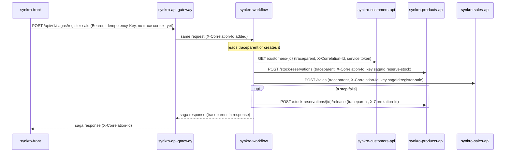

# CP1 - Critical journey and trace map

## Journey

**Register a sale** (`POST /api/v1/sagas/register-sale`).

It is the only write that crosses several domains (Customers, Products and Sales), and it is orchestrated by `synkro-workflow` as a saga with persisted state (ADR-007). If it fails, the salesperson cannot sell, and a failure after reserving stock must be compensated.

## Hop table

| Step | Caller | Callee | Protocol | Operation | Sync/Async | Data |
|---|---|---|---|---|---|---|
| 1 | synkro-front | synkro-api-gateway | REST | POST /api/v1/sagas/register-sale | sync | none |
| 2 | synkro-api-gateway | synkro-workflow | REST | POST /api/v1/sagas/register-sale | sync | workflow_schema (saga_instance) |
| 3 | synkro-workflow | synkro-customers-api | REST | GET /customers/{id} (validate-customer) | sync | customers_schema |
| 4 | synkro-workflow | synkro-products-api | REST | POST /stock-reservations (reserve-stock) | sync | products_schema (stock_reservation) |
| 5 | synkro-workflow | synkro-sales-api | REST | POST /sales (register-sale) | sync | sales database (MongoDB) |
| 6 | synkro-workflow | synkro-products-api | REST | POST /stock-reservations/{id}/release (compensation, only if a step fails) | sync | products_schema |

Steps 3 to 6 do not pass through the gateway. They carry the workflow's service token, and each step sends `Idempotency-Key: <sagaId>:<step>`.

`synkro-auth-api` is not a hop of this journey. It issued the person's JWT and the workflow's service token before the journey starts, and every service validates them locally with the public key.

## Sequence diagram

## Span tree

- `POST /api/v1/sagas/register-sale` (synkro-api-gateway, root span)
  - `POST /sagas/register-sale` (synkro-workflow, child span)
    - `validate-customer`
      - `GET /customers/{id}` (synkro-customers-api)
    - `reserve-stock`
      - `POST /stock-reservations` (synkro-products-api)
    - `register-sale`
      - `POST /sales` (synkro-sales-api)
    - `release-stock` (only on compensation)
      - `POST /stock-reservations/{id}/release` (synkro-products-api)
  - Asynchronous boundary: if the `POST` answers `RUNNING`, the saga keeps running after the HTTP response (or resumes after a restart), and the portal reads it with `GET /api/v1/sagas/{id}`. The spans of the continuation must keep the same `trace_id`.

## Notes

- There is no message broker in the MVP (ADR-007, Decision 5). The only asynchronous boundary is the saga that continues after answering `RUNNING`, and the resumption of `RUNNING` sagas on startup.
- Today the gateway (NGINX) only generates `X-Correlation-Id`. For this workshop, `synkro-workflow` reads the `traceparent` header and creates it if it is missing, so NGINX does not change.
- Open gap: ADR-007 does not say if the correlation id is stored in `saga_instance`. If it is not, a saga resumed after a restart loses its trace. The `trace_id` should be saved with the saga state.
- `X-Correlation-Id` (already used by the project) and `trace_id` (W3C `traceparent`) are different identifiers. The log contract of CP2 keeps both.
