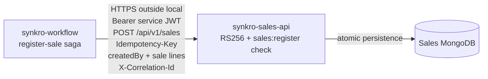

# CP1 — Attack surface: `synkro-workflow` → `synkro-sales-api`

**Author:** Santiago Plazas (`@SantiagoPlazas2005`)  
**Boundary:** internal REST call for step 3 (`register-sale`) of the persistent sale saga.

## Assets

- `SERVICE_TOKEN` for `synkro-workflow` (role `SERVICE`; includes `sales:register`; 30-day expiry).
- Sale record and its `customerId`, product IDs, frozen unit prices, quantities, total and `createdBy`.
- Saga and step state, `Idempotency-Key`, and `X-Correlation-Id`.
- Sales MongoDB availability and integrity.

## Entry points and trust assumptions

| Entry point / data | Trust boundary and validation to inspect |
|---|---|
| `Authorization: Bearer <service JWT>` | Sales must validate RS256, `exp`, `sub`, and the `sales:register` permission itself. Internal network location is not authentication. |
| `POST /api/v1/sales` JSON body | Treat customer, line IDs, quantity, `createdBy`, and any price fields as untrusted input; validate shape and business constraints. Sales calculates totals. |
| `Idempotency-Key: <sagaId>:register-sale` | Validate the format/length and persist it atomically with the sale; retries must not create another sale. |
| `X-Correlation-Id` | Propagate the original value through the saga and participant logs; do not use it as authorization. |
| HTTP response / timeout | A timeout or malformed response does not prove that Sales failed to commit. Follow the evidence-sensitive recovery rules; an uncertain outcome must not trigger unsafe stock release. |
| Environment and logs | The token is a secret; do not commit it or include it in logs, errors, screenshots, or issue text. |

## Boundary diagram

## Initial risk questions for CP2

- Could a leaked or mis-scoped service token register sales?
- Can `createdBy`, sale lines, or prices be tampered with while preserving authorization?
- Can logs and stored records attribute the sale to the validated initiating user and saga?
- Could errors, logs, or database diagnostics disclose the token or sale data?
- Can retries or slow requests exhaust the API/database or create duplicate writes?
- Can any principal other than Workflow pass `sales:register`?

## Evidence to collect

- Boundary-claim issue: [#274](https://github.com/code-corhuila/synkro-docs/issues/274).
- Link to the STRIDE PR and the board stories.
- Link to the actual workflow execution after it has run.
- Library record and a page-specific physical-book citation belong in the STRIDE file and one story; do not put personal loan/visit details in a public issue.

## Project documentation basis

- [ADR-006 — Token Validation in Every Service and Service Credentials](https://github.com/code-corhuila/synkro-docs/blob/main/05-architecture/decisions/records/ADR-006-token-validation-per-service.md): service-token identity, permissions, expiry, and `createdBy` trust.
- [ADR-007 — Persistent Saga Execution and Scheduled Work](https://github.com/code-corhuila/synkro-docs/blob/main/05-architecture/decisions/records/ADR-007-persistent-saga-and-scheduled-work.md): saga step order, idempotency keys, retries, and correlation ID.
- [ADR-015 — Sale Saga Execution Safety](https://github.com/code-corhuila/synkro-docs/blob/main/05-architecture/decisions/records/ADR-015-sale-saga-execution-safety.md): handling ambiguous or malformed participant responses.
- [Security Policy](https://github.com/code-corhuila/synkro-docs/blob/main/00-governance/security-policy.md): secret handling, internal JWT validation, and logging rules.
